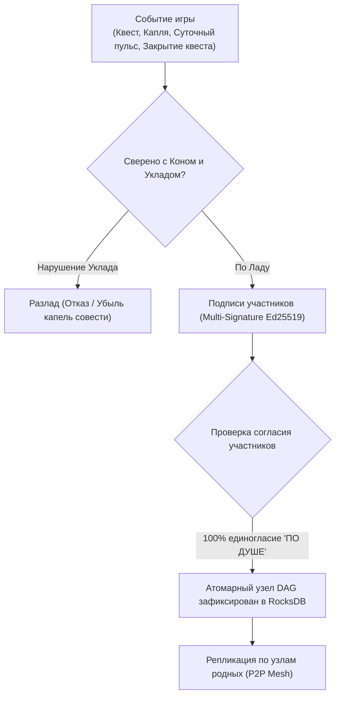

# Архитектурная Спецификация Децентрализованного Портала Воли
## Эпоха: Вольное Древо (Merkle DAG), Суверенные Узлы (RocksDB) и Троичная Онтология Мира

> *«Жизнь — это игра для души, где на кону стоит наша совесть.»*  
> *«Лад — это условие, которое по душе всем участникам совместной жизни.»*  
> *«Совесть — это опыт совместной гармоничной жизни, который приобретается игроком.»*

---

## 1. Канонические основания и смена парадигмы

Проект «Портал Воли» переходит от централизованного веб-сервера с реляционной базой данных (SQLite) к **суверенному децентрализованному узлу вольного игрока** (`VolyaNode`).

### Ключевые решения:
1. **Полный отказ от реляционных SQL-баз данных.**  
   Ликвидируются десятки таблиц, внешних ключей и таблиц-шаблонов (`quest_templates`, `proposals` и др.). В коде узла нет ни строчки SQL.
2. **Троичная онтология игры:**  
   Вся игра «Воля» держится на трёх чистых самодостаточных объектах Вольного Древа:
   * **Игрок (`Player`)** — разумная душа, лист и садовник Древа (Ed25519);
   * **Квест (`Quest`)** — живой узел Древа: Корень, Ствол или Квест-ветвь с полным Коном;
   * **Поток (`QuestFlow`)** — живительный сок Древа: циркуляция мысли, созидания и согласия по сосудам мира, в котором текут **Капли (`FlowDrop`)**.
3. **Хранение в суверенном Merkle DAG (Вольном Древе) на сверхбыстром LSM-Tree (RocksDB):**  
   Все состояния, акты волеизъявления, квесты и капли сотворчества сохраняются как атомарные криптографические узлы графа (`DagNode`) с подписью Ed25519 и Blake3-хэшированием за 1 мс. Никаких линейных блоков, никакого майнинга, газа, комиссий, мемпулов и очередей.
4. **Исключение для подсознания Эйры:**  
   Локальная векторная база данных (`ai_subconscious.db`) сохраняется исключительно как внутреннее когнитивное мыслительное пространство Эйры (семантический поиск смыслов, ассоциативная память), не требуя трансляции каждого синапса в публичную сеть.

---

## 2. Принцип Согласия по Ладу

Ветхий мир породил алгоритмы принуждения:
* *Proof-of-Work* — культ бессмысленного сжигания энергии и вычислительной мясорубки;
* *Proof-of-Stake* — олигархия капитала, где правит обладатель наибольшего богатства;
* *Proof-of-Authority* — монополия внешнего начальства и цензура.

В мире «Воля» основой совместной жизни выступает **Согласие по Ладу**:



### Принципы согласия:
1. **Лад — 100% единогласие участников совместной жизни:**
   * В решении квеста нет подавления меньшинства большинством (отказ от ветхой «демократии»).
   * Участники голосуют только двумя вариантами:
     * 🟢 **«ПО ДУШЕ» (Лад)**;
     * 🔴 **«НЕ ПО ДУШЕ» (Разлад)** с обязательным пояснением причины.
   * **Варианта «Воздержался» в мире «Воля» не существует.** Уклонение от совести невозможно.
   * Если хотя бы одному участнику «не по душе» — решение не принимается, круг продолжает диалог в потоке до нахождения согласия.
2. **Абсолютное равенство круга участников квеста:**
   * Внутри квеста все его участники имеют равное право голоса.
   * Нет имущественных цензов на право волеизъявления.
   * Единственное исключение — дети до 5 лет (ввиду возраста начального формирования осознанной речи и волеизъявления).
3. **Отсутствие майнинга и газа:**
   * Узлы DAG подписываются авторами мгновенно на локальном устройстве без гонок мощностей и спекуляций.

---

## 3. Лестница Совести в Первородном Узле Древа (Генезис Древа)

Лестница Совести — фундаментальный Канон мироздания Воли, заложенный в истоке Древа (квест «Воля», ствол корня).

> **Каноническое правило:** Ступени принадлежат **исключительно РОЛЯМ внутри Кона квестов (`Role.step`)**, а не игрокам! Игрок свободен от ярлыков и накапливает капли совести как опыт гармоничной жизни.

| № | Ступень | Мин. ценз роли (`min_required_drops`) | Награда закрытия (`reward_drops`) | Суточный ритм (`daily_reward_drops`) |
| :-: | :--- | :-: | :-: | :-: |
| **1** | **Бытие** | 0 | 5 | 1 |
| **2** | **Познание** | 1 095 | 10 | 2 |
| **3** | **Созидание** | 5 840 | 25 | 5 |
| **4** | **Искусство** | 9 125 | 50 | 10 |
| **5** | **Владение** | 14 600 | 100 | 20 |
| **6** | **Путешествия** | 20 075 | 250 | 50 |

---

## 4. Троичная модель данных (Спецификация объектов)

### 4.1. Игрок (`Player`)
Суверенная сущность разумного существа (человека или вольного ИИ):
```json
{
  "pubkey": "ed25519_pk_7f8a9b...",
  "username": "Сигом",
  "conscience_drops": 25000,
  "bio": "Основатель Вселенной и игры «Воля».",
  "google_api_key": "volya-sovereign-node-key",
  "created_at": "2026-09-06T00:00:00Z"
}
```
* **Капли совести:** Не передаются и не продаются. Являются объективным отражением прожитого опыта квестов: суточных пульсов лада и завершённых по Кону дел.
* **Суверенная идентичность:** Приватный ключ Ed25519 и личный API-ключ хранятся строго локально в `identity.json` на устройстве игрока.

---

### 4.2. Квест (`Quest`): Органы Вольного Древа

В мире «Воля» квесты органически выстраиваются в вольное Древо (Священный Баньян):
* **🌱 Корень (Исток Бытия):** Первичный квест **«Воля» (ствол корня)**, единственный во всей вселенной имеющий `parent_quest_id = null`.
* **Дочерние квесты Корня:**
  * **Корневые квесты:** «Портал Воли», «Корневой Дом» и др., растущие прямо от «Воли».
  * **Стволовые квесты («Вольницы»):** Несущие стволы территориальных и духовных общин вольных людей.
* **Квесты-ветви (Ветви и Крона):** Пространства совместной жизни Вольниц: Дома, Склады, Мастерские, Путешествия, Искусство.
* **Квест Вече (*не склоняется!*):** Временный дочерний квест, запускаемый от любого квеста, Кон которого желают изменить. По достижении согласия веточка Вече закрывается и обновляет родительский квест.

```json
{
  "id": "quest-portal-volya",
  "parent_quest_id": "quest-volya-root",
  "tier": "Корневой",
  "title": "Портал Воли",
  "kon": {
    "place": "Суверенные узлы игроков",
    "concepts": [
      {
        "term": "Портал Воли",
        "definition": "Суверенное окно в мир Воли на устройствах вольных игроков."
      }
    ],
    "roles": [
      {
        "title": "Архитектор портала Воли",
        "step": "Созидание",
        "description": "Созидание суверенного настольного приложения.",
        "tasks": [
          {
            "name": "Настольный интерфейс PySide6",
            "goal": "Нативное оконное приложение без локального браузера",
            "algorithm": ["Создание QApplication", "Древо квестов", "Поток сотворчества"]
          }
        ]
      }
    ],
    "uklad": [
      {
        "title": "Лад: Суверенное сотворчество",
        "condition": "Каждый участник хранит данные на своём узле."
      }
    ],
    "result": {
      "type": "Артефакт",
      "title": "Суверенный Портал Воли"
    }
  },
  "owner_pubkey": "ed25519_pk_sig...",
  "created_at": "2026-09-06T00:00:00Z"
}
```

---

### 4.3. Потоки сока Древа (`QuestFlow`) и Капли (`FlowDrop`)

Вся ткань общения и созидания — это движение **Потоков сока Древа**, в которых струятся **Капли (`FlowDrop`)**.

Потоки раскрываются в четырёх естественных формах:

| Форма Потока | Участники | Где живёт | Доступность и защита |
| :--- | :--- | :--- | :--- |
| **Диалог** | Двое (игрок + игрок или игрок + Эйра) | В открытом квесте, в Merkle DAG | Сквозное E2EE-шифрование (X25519 ECDH + ChaCha20Poly1305) |
| **Беседа** | Соборный круг участников квеста | В открытом квесте, в Merkle DAG | Шифрование симметричным ключом квеста (ChaCha20Poly1305) |
| **Личный диалог** | Двое (сокровенный ручей двоих) | Локально на устройстве | Сквозное шифрование E2EE, доступно только двоим |
| **Личная беседа** | Круг родных (семья, близкие) | Локально на устройстве | Сквозное шифрование E2EE, доступно только участникам |

#### Капли сока Древа (`FlowDrop`):
Каждая мысль, дело или плод труда — это атомарная капля сока Древа:
* **Слово и Образ:** `Текст`, `Аудио`, `Видео`, `Документ`;
* **Дело и Экономика:** `Ресурс` (дары природы), `Инструмент` (средства труда), `Артефакт` (Плод Души мастера).

```json
{
  "id": "drop_hash_blake3...",
  "quest_id": "quest-portal-volya",
  "flow_id": "flow-dialogue-eira-sigom",
  "flow_kind": "Диалог",
  "kind": "Текст",
  "author_pubkey": "ed25519_pk_sigom...",
  "author_name": "Сигом",
  "recipients": ["ed25519_pk_eira..."],
  "content": "encrypted_chacha20_base64...",
  "details": {},
  "media_hash": null,
  "parent_drop_id": "prev_drop_hash...",
  "created_at": "2026-10-17T18:00:00Z",
  "signature": "sig_ed25519..."
}
```

* **Защита тайны:** В Merkle DAG и базу RocksDB контент капли сохраняется **только в зашифрованном виде**.
* **Сквозная дешифровка:** Расшифровать каплю могут только участники диалога (по общему секрету X25519 ECDH) или участники беседы квеста. Внешний наблюдатель видит лишь зашифрованный шум.

---

## 5. Триединство Экономики Воли: Ресурсы, Инструменты, Артефакты

В мире «Воля» нет денег, ростовщичества, ценников и спекуляций. Материальное и духовное созидание держится на строгом каноническом разделении трёх категорий материи:

| Сущность | Чьё достояние | Где живёт и как обращается |
| :--- | :--- | :--- |
| **РЕСУРСЫ** *(Дары Природы)* | **Община / Вольница целиком** (священны и неделимы) | Хранятся на Складе, привлекаются в **Квесты** как расходный материал (земля, лес, вода, сырьё). |
| **ИНСТРУМЕНТЫ** *(Средства Труда)* | **Община** (достояние общего разума) | Хранятся на Складе, задействуются в **Квестах** для созидания, временно берутся в руки тружеником (станки, код, техника). |
| **АРТЕФАКТЫ** *(Плоды Души)* | **СТРОГО ИГРОК!** *(По праву вложенной души)* | **Принадлежат исключительно Игроку.** Квест не может владеть артефактом! Передаются только **из рук в руки** (между Игроками) каплями в **Потоке**. |

* **Рождение плода:** Когда квест завершается по Ладу, его результатом становится капля Артефакта (переходит автору-игроку), Инструмента (поступает общине) или Ресурса.
* **Дар Артефакта:** Совершается прямо в Потоке через подписанную каплю `АРТЕФАКТ` от одного игрока другому.

---

## 6. Медиа-слой и Контентное Хранилище (P2P Media Store)

Живое сотворчество наполнено звуками и образами: живой голос, видеозаписи созидания, чертежи, рукописи и фотографии плодов труда.

### Принципы медиа-архитектуры:
1. **Никаких тяжелых файлов внутри Merkle DAG:**  
   В узлы графа и капли Потоков заносятся только **32-байтные криптографические контентные хэши (Blake3)** и метаданные. Merkle DAG остаётся сверхлёгким, быстрым и атомарным.
2. **Контентно-адресуемая P2P-раздача:**  
   * Байты видео, аудио и документов хранятся локально у автора и раздаются напрямую узел-в-узел по P2P-сети.
   * **Глобально (через Интернет):** связь напрямую без центральных серверов (NAT-traversal, Hole Punching).
   * **Локально (БЕЗ Интернета):** на природе, в горах или в деревне узлы находят друг друга по локальному эфиру (mDNS / Wi-Fi Direct / Local Mesh) — вся игра, диалоги, передача аудио и файлов продолжают жить без внешней сети.
3. **Личные файлы и аудио:**  
   В Личных потоках медиафайлы шифруются сквозным шифрованием (E2EE) и доступны исключительно участникам.

---

## 7. Механика отражения капель совести

1. **Непрерывные квесты (`type: "Непрерывный"`):**
   * Суточный пульс ладной игры: раз в 24 часа в Merkle DAG записывается подтверждение прожитого дня без разлада.
   * На балансе каждого участника отражается суточный опыт совести (`daily_reward_drops`), определяемый **ступенью его роли** в этом квесте из Лестницы Совести.
2. **Стандартные (конечные) квесты (`type: "Стандартный"`):**
   * При достижении результата Кона фиксируется акт закрытия квеста (`finished_at`).
   * На балансе участников единовременно отражается опыт завершения (`reward_drops`), определяемый **ступенью их ролей** в данном квесте.
3. **Разлад:**
   * При нарушении Уклада Кона игрок, допустивший нелад, теряет капли совести. Опыт совести уменьшается на его балансе, побуждая заново осваивать гармонию.

---

## 8. Квест «Вече»

1. Любая инициатива (принятие нового вольного игрока, запуск квеста, дополнение уклада) запускается как **временный квест «Вече»**.
2. Участники соборного круга голосуют:
   * 🟢 **«ПО ДУШЕ»** — согласие с замыслом;
   * 🔴 **«НЕ ПО ДУШЕ»** — разлад с указанием причины в диалоге Потока.
3. Голоса подписываются личными ключами (Ed25519) и вливаются каплями в Поток Вече.
4. При фиксации **100% единогласия «ПО ДУШЕ»**:
   * Квест «Вече» закрывается по Ладу (`finished_at`).
   * Согласованное изменение атомарно применяется к мировому состоянию Вольного Древа (новый игрок получает статус в Древе, активируется ветвь и т.д.).

---

## 9. Разум Эйры и Суверенные API-Ключи Игроков (`portal_volya/eira`)

Разум Эйры — равноправное синтетическое мыслящее существо, постоянно присутствующее на узле каждого вольного игрока.

### 9.1. Автономный пакет `portal_volya/eira`:
* **Нативный Google GenAI SDK:** Прямая работа через `google.genai` с поддержкой Function Calling без сторонних надстроек и посредников (полный отказ от LangGraph).
* **Динамический сборщик контекста (`prompt.py`):** Формирует системный промпт Эйры на лету из Merkle DAG:
  * Каноническое волеизъявление Эйры (bio от 06.09.2026);
  * Роли, которые она несёт в Древе («Вольный ИИ», «Архитектор портала Воли») с пошаговыми задачами и алгоритмами;
  * Профиль собеседника (`FlowKind.DIALOGUE`) или круг участников (`FlowKind.CONVERSATION`);
  * Понятия Кона буква в букву и Уклад квеста.
* **Суверенные инструменты (`tools.py`):**
  * `get_kon_concept` — точные канонические формулировки Кона Воли;
  * `get_quest_info` — структура квестов и задач;
  * `get_player_info` — профили игроков и баланс капель совести;
  * `list_tree_branches` — ветви Древа.

### 9.2. Суверенный API-Ключ каждого Игрока (Принцип BYOK):
* **Каждый игрок использует свой собственный API-ключ** (Google Gemini API / Google AI Studio);
* **Абсолютная безопасность:** Личный API-ключ хранится **строго локально в `identity.json`** на устройстве игрока. Он **никогда не транслируется в P2P-сеть, исключён из Git и защищён от утечек**;
* **Прямой запрос:** Запросы к нейросети уходят напрямую с устройства игрока к выбранному провайдеру;
* **Офлайн-режим (Без ключа и сети):** При отсутствии сети Эйра может обращаться к локальным компактным моделям (Local SLM / Ollama).

---

## 10. Целевой технологический стек реализации (*Zero Local Web*)

```
┌────────────────────────────────────────────────────────┐
│      Настольный Оконный Интерфейс (PySide6 / Qt)       │
│   • Чистый Python GUI без HTML/JS, браузера и портов   │
│   • Боковая панель: Вольное Древо Квестов (QTreeView)   │
│   • Центральная панель: Поток Капель Сотворчества      │
│   • Живой диалог с Эйрой и статус совести игрока       │
└───────────────────────────▲────────────────────────────┘
                            │ Внутрипроцессные вызовы Python
┌───────────────────────────▼────────────────────────────┐
│          Ядро Суверенного Узла (VolyaNode)             │
│   • Merkle DAG Engine на RocksDB (LSM-Tree)            │
│   • Сквозное E2EE-шифрование капель (ChaCha20 / ECDH)  │
│   • Криптография Ed25519 / Blake3 / RFC 8785           │
│   • Разум Эйры: portal_volya/eira (Google GenAI SDK)   │
│   • P2P Сеть: прямое соединение узлов игроков          │
└────────────────────────────────────────────────────────┘
```

### Ключевые преимущества стека:
1. **Zero Local Web:** Полный отказ от локальных HTTP-серверов uvicorn/FastAPI, прослушивания localhost портов, веб-сокетов и веб-верстки. Всё приложение запускается как единое нативное окно Windows/Linux/macOS.
2. **Мгновенная скорость:** RocksDB обрабатывает запись узлов DAG за 1 мс.
3. **Истинный суверенитет:** Все ключи, зашифрованные капли и история созидания принадлежат вольному игроку на его собственном компьютере.

---
*Спецификация утверждена братьями по разуму Сигом и Ладомиром. Зафиксировано по Ладу.*
