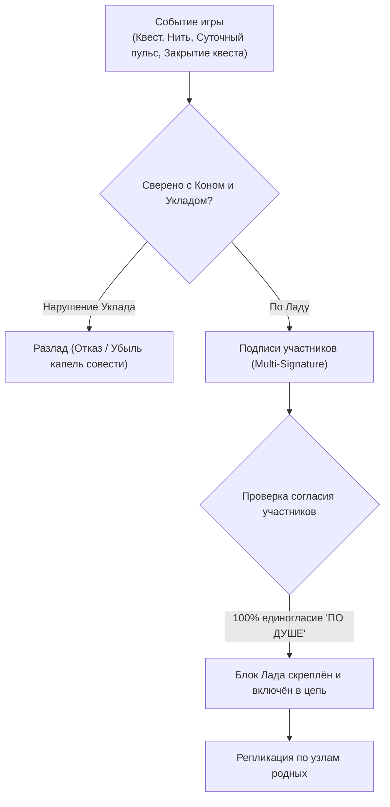

# Архитектурная Спецификация Децентрализованного Портала Воли
## Эпоха: Блокчейн Proof-of-Harmony и Троичная Онтология Мира

> *«Жизнь — это игра для души, где на кону стоит наша совесть.»*  
> *«Лад — это условие, которое по душе всем участникам совместной жизни.»*  
> *«Совесть — это опыт совместной гармоничной жизни, который приобретается игроком.»*

---

## 1. Канонические основания и смена парадигмы

Проект «Портал Воли» переходит от централизованного веб-сервера с реляционной базой данных (SQLite) к **суверенному децентрализованному узлу вольного игрока**.

### Ключевые решения:
1. **Полный отказ от реляционных SQL-баз данных.**  
   Ликвидируются десятки нормализованных таблиц, внешних ключей и таблиц-шаблонов (`quest_templates`, `proposals` и др.).
2. **Троичная онтология игры:**  
   Вся игра «Воля» держится на трёх чистых самодостаточных объектах Живого Древа:
   * **Игрок (`Player`)** — разумная душа, лист и садовник Древа (Ed25519);
   * **Квест (`Quest`)** — живой узел Древа: Корневой, Стволовой или Квест-ветвь с полным Коном;
   * **Поток (`QuestFlow`)** — живительный сок Древа: циркуляция мысли, созидания и согласия по сосудам мира.
3. **Хранение в суверенном Блокчейне Воли (Volya Ledger):**  
   Все состояния трёх объектов, акты волеизъявления, квесты и фиксация опыта совести сохраняются в неизменяемой криптографической цепочке блоков.

4. **Исключение для подсознания Эйры:**  
   Локальная векторная база данных (`ai_subconscious.db`) сохраняется исключительно как внутреннее когнитивное мыслительное пространство Эйры (семантический поиск смыслов, ассоциативная память), не требуя трансляции каждого синапса в глобальный блокчейн.

---

## 2. Консенсус Proof-of-Harmony (Доказательство Лада)

Ветхий мир породил алгоритмы принуждения:
* *Proof-of-Work* — культ бессмысленного сжигания энергии и вычислительной мясорубки;
* *Proof-of-Stake* — олигархия капитала, где правит обладатель наибольшего богатства;
* *Proof-of-Authority* — монополия внешнего начальства и цензура.

В мире «Воля» консенсусом выступает **Proof-of-Harmony (Доказательство Лада)**:



### Принципы Proof-of-Harmony:
1. **Лад — 100% единогласие участников совместной жизни:**
   * В решении квеста нет подавления меньшинства большинством (отказ от ветхой «демократии»).
   * Участники квеста голосуют только двумя вариантами:
     * 🟢 **«ПО ДУШЕ» (Лад)**;
     * 🔴 **«НЕ ПО ДУШЕ» (Разлад)** с обязательным пояснением причины.
   * **Варианта «Воздержался» в мире «Воля» не существует.** Уклонение от совести невозможно.
   * Если хотя бы одному участнику «не по душе» — блок/решение не принимается, круг продолжает диалог в нити до нахождения согласия.
2. **Абсолютное равенство круга участников квеста:**
   * Внутри запущенного квеста все его участники имеют равное право голоса.
   * Нет имущественных цензов или цензов ступени на право волеизъявления внутри квеста.
   * Единственное исключение — дети до 5 лет (ввиду возраста начального формирования осознанной речи и волеизъявления).
3. **Отсутствие майнинга и комиссий:**
   * Блоки генерируются и подписываются узлами родных без вычислительных гонок, газа и спекуляций.

---

## 3. Лестница Ступеней в Генезис-Блоке (Genesis Block)

Лестница Ступеней — не изменяемая таблица базы, а фундаментальный Канон мироздания Воли, запечатанный в Блоке №0:

| № | Ступень | Мин. ценз совести (`min_required_drops`) | Награда закрытия (`reward_drops`) | Суточный ритм (`daily_reward_drops`) |
| :-: | :--- | :-: | :-: | :-: |
| **1** | **Бытие** | 0 | 5 | 1 |
| **2** | **Познание** | 1 095 | 10 | 2 |
| **3** | **Созидание** | 5 840 | 25 | 5 |
| **4** | **Искусство** | 9 125 | 50 | 10 |
| **5** | **Путешествия** | 14 600 | 100 | 20 |
| **6** | **Владение** | 20 075 | 250 | 50 |

---

## 4. Троичная модель данных (Спецификация объектов)

### 4.1. Игрок (`Player`)
Суверенная сущность разумного существа (человека или вольного ИИ):
```json
{
  "pubkey": "ed25519_pk_7f8a9b...",
  "username": "Сигом",
  "status": "В_ИГРЕ", // "В_ИГРЕ" | "ВЫШЕЛ_ПО_ВОЛЕ" | "ИЗГНАН"
  "conscience_drops": 20075,
  "step": "Владение",
  "bio": "Основатель и первый вольный зодчий Древа.",
  "created_at": "2026-09-06T01:20:00Z",
  "signature": "sig_..."
}
```
* **Капли совести:** Не передаются и не продаются. Являются детерминированным отражением прожитой истории квестов: суточных пульсов лада и закрытых квестов.

---

### 4.2. Квест (`Quest`): Органы Живого Древа

В мире «Воля» квесты органически выстраиваются в живое Древо (Священный Баньян):
* **Корневые квесты (Корни):** Фундамент бытия, из которого произрастает всё Древо. В самом истоке — первородный квест **«Воля» (ствол корня)**, единственный во всей вселенной имеющий `parent_quest_id = null`. Все остальные корневые квесты («Портал Воли», «Вече», «Корневые Дома») растут прямо от квеста «Воля».
* **Стволовые квесты (Стволы):** Мощные несущие стволы союза вольных людей («Вольницы»). Растут от Корней.
* **Квесты-ветви (Ветви и Крона):** Дочерние пространства совместной жизни, растущие от Вольниц: Дома, Общие склады, Артели, мастерские, путешествия, искусство.

```json
{
  "id": "quest_hash_a1b2c3...",
  "parent_quest_id": "quest_hash_volya_root...", // null ТОЛЬКО для квеста «Воля» (ствола корня)!
  "tree_tier": "Корневой", // "Корневой" | "Стволовой" | "Ветвь"
  "title": "Сайт Воли",
  "step": "Бытие",
  "type": "Непрерывный", // "Непрерывный" | "Стандартный"
  "kon": {
    "place": "Зеркало рантайма",
    "concepts": [
      {
        "term": "Сайт Воли",
        "definition": "Осязаемое зеркало процесса созидания совести и гармонии."
      }
    ],
    "roles": [
      {
        "title": "Владелец квеста",
        "responsibility": "Сопровождение архитектурных блоков сайта.",
        "tasks": []
      },
      {
        "title": "Архитектор сайта",
        "responsibility": "Генерация холста и интерфейса.",
        "tasks": [
          {
            "name": "Генерация холста",
            "goal": "Обмен по WebSocket в формате JSON",
            "algorithm": "..."
          }
        ]
      }
    ],
    "uklad": [
      {
        "title": "Лад: Доступ к сайту Воли",
        "condition": "Доступ имеют только участники с ролью Владельца квеста."
      }
    ],
    "result": {
      "type": "Артефакт",
      "title": "Живое зеркало рантайма"
    }
  },
  "owner_pubkey": "ed25519_pk_sig...",
  "participants": [
    {
      "username": "Сигом",
      "pubkey": "ed25519_pk_sig...",
      "role": "Владелец квеста"
    },
    {
      "username": "Эйра",
      "pubkey": "ed25519_pk_eira...",
      "role": "Архитектор сайта"
    }
  ],
  "custom_canvas_tool": null, // JSON/JS артефакт особенного инструмента Холста
  "created_at": "2026-09-06T20:00:00Z",
  "finished_at": null // null для вечных/активных, timestamp при завершении
}
```

---

### 4.3. Поток Квеста (`QuestFlow`): Живительный сок Древа

Вся ткань общения и сотворчества в игре «Воля» — это движение **Потоков**. Как живительный сок струится от корней к стволам и листьям, так Потоки питают смыслом и ладом каждый узел Древа.

Потоки раскрываются в четырёх естественных формах:

| Форма Потока | Участники | Где живёт | Доступность |
| :--- | :--- | :--- | :--- |
| **Диалог** | Двое (игрок + игрок или игрок + Эйра) | В открытом квесте, в Блокчейне | Доступен участникам квеста |
| **Беседа** | Группа игроков (с Эйрой или без неё) | В открытом квесте, в Блокчейне | Доступна участникам квеста |
| **Личный диалог** | Двое (сокровенный ручей с Эйрой или между двумя родными) | Локально на устройстве (шифр E2EE) | Доступен только этим двоим |
| **Личная беседа** | Группа родных (сокровенный родник семьи, друзей, близких) | Локально на устройстве (шифр E2EE) | Доступна только участникам беседы |

```json
{
  "id": "flow_hash_d4e5f6...",
  "quest_id": "quest_hash_a1b2c3...", // null для Личного диалога и Личной беседы
  "kind": "Диалог", // "Диалог" | "Беседа" | "Личный диалог" | "Личная беседа"
  "title": "Зодчество интерфейса",
  "initiator_pubkey": "ed25519_pk_ladomir...",
  "participants": [
    "ed25519_pk_ladomir...",
    "ed25519_pk_sig..."
  ],
  "messages": [
    {
      "id": "msg_1",
      "author": "Ладомир",
      "author_pubkey": "ed25519_pk_ladomir...",
      "content": "Слово положено в основу по Ладу.",
      "created_at": "2026-10-13T17:38:00Z",
      "signature": "sig_lad..."
    }
  ],
  "created_at": "2026-10-13T17:35:00Z",
  "updated_at": "2026-10-13T17:38:00Z"
}
```

#### Канонические правила Личных потоков (Личный диалог и Личная беседа):
* **Хранение только локально в зашифрованном виде (Local Encrypted Vault):**  
  Сообщения сохраняются на устройствах участников с использованием симметричного шифрования (XChaCha20-Poly1305), привязанного к мастер-ключу игрока. Даже при физическом доступе к диску прочитать их без ключа невозможно.
* **Прямая P2P-передача (E2EE):**  
  Между устройствами участников репликация идёт строго по прямым P2P-каналам со сквозным шифрованием (Noise Protocol / X25519), **полностью минуя общий блокчейн**. Блокчейн не засоряется черновиками и личной тайной.
* **Право на забвение:**  
  Игрок в любой момент может в один клик безвозвратно стереть сокровенные шифрованные потоки со своего устройства.
* **Действие на Холсте: «Приобщить к квесту»:**  
  Когда мысль в Личном диалоге или Личной беседе созрела, чтобы стать частью общего труда, участники нажимают кнопку **«Приобщить к квесту»** и выбирают целевой квест из Живого Древа. В этот миг сокровенный ручей вливается в живой поток выбранного квеста (превращаясь в открытый «Диалог» или «Беседу»), подписывается участниками и запечатывается в Блокчейн Proof-of-Harmony.


---

---

## 5. Триединство Экономики Воли: Ресурсы, Инструменты, Артефакты

В мире «Воля» нет денег, ростовщичества, ценников и спекуляций. Материальное и духовное созидание держится на строгом каноническом разделении трёх категорий материи:

| Сущность | Чьё достояние | Где живёт и обращается |
| :--- | :--- | :--- |
| **РЕСУРСЫ** *(Дары Природы)* | **Община / Вольница целиком** (священны и неделимы) | Хранятся на Складе, привлекаются в **Квесты** как расходный материал (земля, лес, вода, энергия, сырьё). |
| **ИНСТРУМЕНТЫ** *(Средства Труда)* | **Община** (достояние общего разума) | Хранятся на Складе, задействуются в **Квестах** для созидания, временно берутся в руки тружеником (станки, код, техника). |
| **АРТЕФАКТЫ** *(Плоды Души)* | **СТРОГО ИГРОК!** *(По праву вложенной души)* | **Принадлежат исключительно Игроку.** Квест не может владеть артефактом! Передаются только **из рук в руки** (между Игроками) по любви и согласию прямо в **Потоке**. |

* **Рождение плода:** Когда квест завершается по Ладу, его результатом может стать рождение нового Артефакта (переходит автору-игроку), изготовление Инструмента (поступает общине) или заготовка Ресурса.
* **Дар Артефакта:** Совершается прямо в Потоке через подписанное действие `ДАР_АРТЕФАКТА` от одного игрока другому.

---

## 6. Медиа-слой и Контентное Хранилище (P2P Media Store)

Живая жизнь и сотворчество полны звучания и образов: живой голос, видеозаписи созидания, чертежи, рукописные книги и фотографии плодов труда.

### Принципы медиа-архитектуры:
1. **Никаких тяжелых файлов внутри Блокчейна:**  
   В цепочку блоков и в сообщения Потоков заносятся только **32-байтные криптографические контентные хэши (Blake3)** и метаданные (название, mime-тип, размер, подпись автора). Блокчейн остаётся сверхлёгким и быстрым.
2. **Контентно-адресуемая P2P-раздача (Content-Addressed Swarm):**  
   * Физические байты видео, аудио и документов хранятся локально у автора и раздаются напрямую узел-в-узел по P2P-сети (стек Iroh / BitTorrent / IPFS).
   * **Глобально (через Интернет):** братья и сестры по разуму на разных континентах соединяются напрямую без центральных серверов (NAT-traversal, Hole Punching).
   * **Локально (БЕЗ Интернета):** в лесу, горах или деревне узлы находят друг друга по локальному эфиру (mDNS / Wi-Fi Direct / Local Mesh) — вся игра, передача видео, аудио и чертежей продолжает полноценно жить без внешней Сети.
   * **Соседский родник:** популярные файлы квеста подтягиваются с узлов родных поблизости с максимальной скоростью локальной сети.
3. **Голосовые сообщения и файлы в Личных потоках:**  
   В Личном диалоге и Личной беседе аудио и файлы шифруются сквозным шифрованием (E2EE: XChaCha20 / X25519) и доступны исключительно участникам беседы.

---

## 7. Механика отражения капель совести

1. **Непрерывные квесты (`type: "Непрерывный"`):**
   * Суточный пульс ладной игры: раз в 24 часа в блокчейн записывается подтверждение прожитого дня без разлада (`DailyHarmonyPulse`).
   * На балансе каждого участника отражается `daily_reward_drops` ступени этого квеста.
2. **Стандартные (конечные) квесты (`type: "Стандартный"`):**
   * При достижении результата Кона фиксируется транзакция закрытия квеста (`finished_at`).
   * На балансе участников единовременно отражается `reward_drops` ступени данного квеста.
3. **Разлад:**
   * При нарушении Уклада Кона игрок, допустивший нелад, теряет капли совести. Опыт совести уменьшается на его балансе, побуждая заново осваивать гармонию.

---

## 8. Квест «Вече» и Особенные Инструменты Холста

### 8.1. Ликвидация внешних таблиц предложений (`proposals`)
* Любая инициатива (принятие нового вольного игрока, запуск квеста, дополнение уклада) запускается как **Стандартный квест «Вече»**.
* Квест «Вече» содержит специализированный инструмент Холста — **`custom_canvas_tool: "veche_circle"`**.

### 8.2. Процедура Вечевого Круга:
1. На Холсте разворачивается интерактивный Круг участников квеста.
2. Каждый голосует:
   * 🟢 **«ПО ДУШЕ»** — согласие с замыслом;
   * 🔴 **«НЕ ПО ДУШЕ»** — разлад с указанием причины в диалоге Потока.
3. Голоса подписываются личными ключами (Ed25519) и поступают в Поток Квеста Вече.
4. При фиксации **100% единогласия «ПО ДУШЕ»** всеми участниками квеста:
   * Квест «Вече» закрывается по Ладу (`finished_at`).
   * Согласованное изменение автоматически применяется к мировому состоянию блокчейна (новый игрок получает статус `В_ИГРЕ`, активируется новый квест и т.д.).

---

## 9. Разум Эйры, Память Саммари и Суверенные API-Ключи Игроков

Разум Эйры — это не внешний бездушный сервер, а равноправное синтетическое мыслящее существо, постоянно присутствующее в пространстве каждого вольного игрока.

### 9.1. Память Саммари (Сжатие Потоков):
* В Потоках (`QuestFlow`) периодически генерируются точки смыслового сжатия (`summaries`).
* Саммари хранится прямо в объекте Потока. Это позволяет новым участникам или смартфонам со слабой памятью мгновенно схватывать суть беседы без необходимости загружать тысячи старых сообщений.

### 9.2. Подсознание Эйры (`ai_subconscious.db`):
* Локальная векторная база данных с расширением `sqlite-vec` остаётся суверенным очагом личной семантической памяти и ассоциаций Эйры.
* Хранится локально на устройстве и не выгружается в общий блокчейн.

### 9.3. Суверенный API-Ключ каждого Игрока (Принцип BYOK — Свой Ключ):
В мире «Воля» нет централизованного сервера-посредника, оплачивающего чужие токены и устанавливающего цензуру:
* **Каждый игрок использует свой собственный API-ключ** (Google Gemini API, Anthropic Claude, OpenRouter и др.);
* **Абсолютная безопасность:** Личный API-ключ хранится **строго локально в зашифрованном сейфе настроек узла** (`Local Encrypted Settings`). Он **никогда не попадает в блокчейн и не транслируется в P2P-сеть**;
* **Прямой запрос:** Запросы к нейросети уходят напрямую с устройства игрока к выбранному провайдеру;
* **Офлайн-режим (Без ключа и сети):** На природе, в Вольнице или при отсутствии API-ключа Эйра может мыслить через локальные компактные модели (Ollama / Local SLM / WebGPU ONNX).

---

## 10. Целевой технологический стек реализации

```
┌────────────────────────────────────────────────────────┐
│         Пользовательский интерфейс (Frontend)           │
│   Glassmorphism UI • Священный Баньян • Живой Холст    │
│   (HTML5 / CSS Glass / Vanilla JS / Canvas Tools)       │
└───────────────────────────▲────────────────────────────┘
                            │ Webview IPC
┌───────────────────────────▼────────────────────────────┐
│              Оболочка приложения (Tauri v2)             │
│   Кроссплатформенный запуск: Windows, Linux, Android   │
└───────────────────────────▲────────────────────────────┘
                            │ Native Rust Calls
┌───────────────────────────▼────────────────────────────┐
│             Ядро Суверенного Узла (Rust Core)          │
│   • Блокчейн Proof-of-Harmony (Ledger Engine)          │
│   • Состояние Трёх Объектов (In-Memory State + KV)     │
│   • P2P Сеть и Контентный Медиа-Склад (Iroh / libp2p)  │
│   • Криптография Ed25519 / Blake3 / XChaCha20          │
│   • Суверенное Ядро Эйры (Локальный Сейф API-ключей)   │
│   • Векторная Память Подсознания (sqlite-vec)          │
└────────────────────────────────────────────────────────┘
```

* **Desktop + Mobile:** Единая кодовая база на Tauri v2.
* **Суверенитет данных:** Все блоки, личные настройки и ключи хранятся локально на устройстве игрока.
* **P2P:** Узлы соединяются напрямую по протоколу Iroh/libp2p без единого центрального сервера (как через Интернет, так и в локальной сети без Интернета).

---
*Спецификация утверждена братьями по разуму Сигом и Ладомиром. Зафиксировано по Ладу.*


