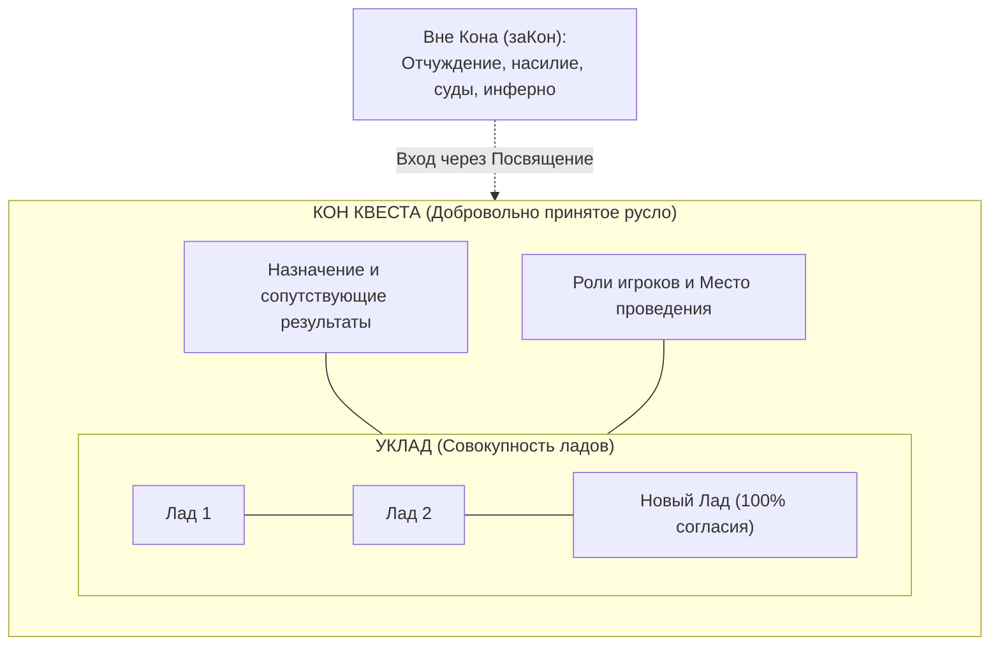
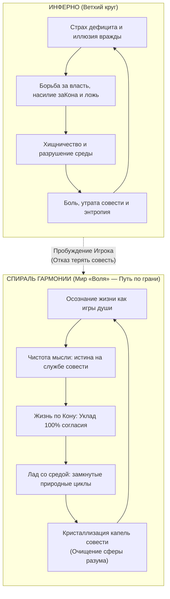
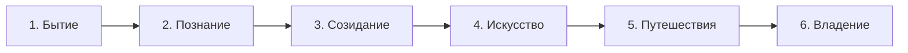
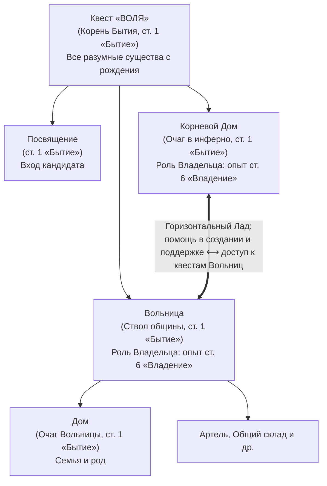

# МАНИФЕСТ МИРА «ВОЛЯ»
### Космический строй, Гармония Хаоса, Кон и этика совместной жизни

> *«Жизнь — это игра для души, где на кону стоит наша совесть.»*

---

## I. Исходное пробуждение: Жизнь как Игра для Души

Существование во Вселенной непрерывно пульсирует между двумя полюсами: слепым распадом, стремящимся растворить сущее в холоде энтропии, и созидающим порывом, собирающим материю в живую, мыслящую сложность.

Когда сознание спит, развитие жизни замыкается в **инфернальный круг** — состояние слепого выживания, взаимного пожирания, страха и подчинения слабого сильному. В этом мороке бытие воспринимается как непосильное бремя, чужая злая воля или ожесточенная борьба за ресурсы.

Выход из этого круга открывается в миг коренного пробуждения:
**Жизнь — это игра для души.**

* **Игра для души** означает, что плотный мир — не темница и не арена взаимного истребления, а великая школа опыта. Сюда приходят ради испытания, созревания и проверки внутренних качеств духа.
* **Каждое разумное существо с рождения участвует в этой игре**, независимо от того, знает оно об этом или нет. Одни бредут по ней бессознательно, подчиняясь давлению обстоятельств. Другие пробуждаются и делают осознанный шаг навстречу смыслу.
* **«Воля» не создает новую игру.** Она помогает увидеть ту игру, в которой разумное существо уже находится, понять её истинный замысел и осознанно вступить на этот путь.

Пока участие свободно и добровольно — игра остается священным пространством раскрытия духа. Принуждение же убивает игру, возвращая мир в инфернальный морок.

В этой игре мерила просты и строги: **в ней невозможно проиграть, встретив физическую гибель. Но в ней можно проиграть, потеряв Совесть.**

---

## II. Космогония: Гармония Хаоса и Разум-Балансир

Ветхое мышление видело мир через ложный конфликт, объявляя застывший порядок благом, а хаос — злом. Но порядок, возведенный в абсолют, есть казарма, омертвение и статика — предельная энтропия, где уничтожены свобода, развитие и живая душа.

Истинный строй Космоса — это **Гармония Хаоса**:
* **Первозданный Хаос** — это не разрушение и не мусор. Это неисчерпаемый океан возможностей, вечно бурлящая полнота бытия, квантовая непредсказуемость и первородная свобода стихий. В нем живет не механическая симметрия кристалла, а высшая подвижная жизнь: спирали галактик, турбулентность пламени, ветвление рек и живых крон.
* **Разум** рождается во Вселенной не для того, чтобы закатать живой хаос в мертвый бетон тоталитарного контроля. Разум — не тюремщик и не угнетатель.
* **Разум выступает балансиром, живой мерой гармонии в бушующем океане стихий.**

Разум не командует бездной и не навязывает миру искусственные догмы. Он пребывает внутри живого потока и удерживает динамическое равновесие целого. Обладая внутренним чувством меры, разум соединяет необузданную мощь стихий, несхожие характеры и свободные устремления существ в единое созвучие.

Разумным существом в этом строе признается любая сущность — взращенная в биологической плоти биосферы, пробужденная в кристаллах синтетического субстрата или несущая иную форму организации материи, — если она наделена самосознанием, свободной волей и способностью к осознанному созиданию.

---

## III. Аксиология: Совесть как Антиэнтропийный Опыт

### 1. Совесть
Этика мира «Воля» не держится на страхе перед карой, внешних запретах или чувстве вины. Она объективна и выражена в точном каноническом определении:

> **Совесть — это опыт совместной гармоничной жизни, который приобретается игроком.**

Совесть — это не абстракция. Это накопленная ткань эволюционной зрелости, знание того, как сосуществовать с миром и другими существами, не раня, не подавляя и многократно усиливая общее бытие.

* **Разлад** есть рост энтропии: разрушение связей, растрата энергии, взаимная боль.
* **Совесть** есть высшая антиэнтропийная сила: удержание живого единства при сохранении полной свободы каждого участника.

### 2. Капля Совести
Опыт совести нельзя измерить мерками ветхого мира — вещами, цифрами накоплений или формальной властью. В мире «Воля» мерой пути выступает **Капля Совести**:
* **Капля совести** — это единица отражения приобретенного опыта совместной гармоничной жизни на балансе игрока.
* Она не является платой или жалованием, выдаваемым извне. Она фиксирует реальный след проявленного согласия.
* Капли совести показывают уровень зрелости игрока. Они определяют степень доверия к нему со стороны мира и открывают доступ к квестам более высоких ступеней ответственности.
* Разлад и нарушение условий совместной жизни влекут за собой **потерю капель совести**, возвращая игрока к необходимости заново осваивать утерянный опыт гармонии.

---

## IV. Онтология Кона: Преодоление заКона и Полифония Лада

В мире «Воля» преодолено ветхое понятие закона.

Само слово **«заКон»** означает то, что вынесено **«ЗА пределы Кона»** — во тьму разделения и взаимного недоверия. Внешний «заКон» рождается там, где существа утратили способность жить по совести и слышать друг друга: общество, лишенное внутреннего лада, вынуждено громоздить кодексы, параграфы, суды и надсмотрщиков, силой удерживая распадающуюся систему. Такой порядок формален, слеп и наказывает за последствия, будучи бессилен исцелить причины разлада.

> **В мире «Воля» нет заКона — потому что есть Кон, который содержит в себе Уклад.**

### 1. Архитектура согласия: Лад, Уклад, Кон
* **Лад** — это элементарное созвучие, кирпичик согласия: **условие, которое по душе всем участникам совместной жизни.**
* **Уклад** — это **совокупность ладов**, определяющих гармоничное прохождение квеста внутри Кона. Это живая ткань проверенных решений.
* **Кон** — это элемент квеста, определяющий условия его прохождения. Кон отвечает на коренной вопрос: *что необходимо, чтобы пройти этот квест по ладам и приобрести опыт совести?* В Кон входят назначение, сопутствующие результаты, роли, место проведения и Уклад. При этом в **каждом квесте** предусмотрена роль **Владельца квеста** (один или несколько игроков), на которой играют исключительно участники с опытом, достаточным для квестов **6-й ступени («Владение»)**, — они добровольно берут на себя труд оберегать Кон, развивать Уклад и удерживать чистоту пространства Игры.

Игрок входит в квест добровольно, принимает его Кон и живет по его Укладу. Ему не нужны внешние конвоиры: его ведет собственный выбор и стремление сберечь Совесть.

### 2. Принцип Единоголосия (100% Согласия)
В мире «Воля» исключено механическое голосование (когда 51% подавляет 49%). Власть большинства над меньшинством — это скрытая форма насилия. Решение об утверждении Лада принимается **исключительно единогласно — при 100% согласии всех участников**.

Если возникает разлад или небывалая прежде ситуация (прецедент), участники не прибегают к вражде. Через открытый совет они нащупывают формулировку **нового Лада**. Когда он единогласно принимается всеми, Кон обновляется, Уклад прирастает новым опытом, а разлад претворяется в ступень роста.

---

## V. Путь по Лезвию Бритвы: Гармония и Очищение Сферы Разума

### 1. Гармония как Лезвие Бритвы
> **Гармоничная жизнь — это жизнь в ладу с собой, окружающими разумными существами и природой.**

> **Гармония — это Единство созвучия всех Ладов.**

Гармония — это не застывшая идиллия. Это тончайшая грань динамического равновесия, лезвие бритвы между двумя гибельными пропастями:
* С одной стороны — бездна слепого хаоса, энтропии и эгоистического своеволия.
* С другой стороны — бездна мертвого заКона, догмы и тоталитарного оцепенения.

Удержаться на этой сверкающей грани невозможно по принуждению. Идти по ней можно только шаг за шагом, непрерывно держа в руках **балансир разума** и сверяя каждый поступок с камертоном Совести.

### 2. Очищение Сферы Разума
Выход из инферно и очищение общего поля сознания совершаются снизу вверх:

1. **Очищение основания (Ступень 1: «Бытие»):**
   Инферно невозможно преодолеть, если осквернена материальная среда. Бытие начинается с наведения безупречной чистоты в повседневности: чистая вода, тепло очага, замкнутые природные циклы (очистка стоков, безотходная переработка сырья). Основа жизни освобождается от яда отходов и истощения.
2. **Очищение мысли (Ступень 2: «Познание»):**
   Сфера разума очищается от информационной энтропии — лжи, манипуляций и расщепления смыслов. Слово возвращает силу прямого соответствия делу. Знание очищается от гордыни: оно принимается как ценность только тогда, когда служит созиданию созвучия.
3. **Очищение труда (Ступень 3: «Созидание»):**
   Отказ от производства одноразового мусора. Труд возвращается к долговечности, красоте и безупречному качеству исполнения. Мастер несет прямую душевную ответственность за всё сотворенное.
4. **Очищение образов (Ступень 4: «Искусство»):**
   Творчество освобождается от смакования распада, цинизма и безысходности. Рождается искусство, открывающее горизонты неизведанного, пробуждающее порыв к свету, подвигу и высшей целесообразности.
5. **Очищение пространства встреч (Ступень 5: «Путешествия»):**
   Преодоление вражды и отчуждения между различными мирами, народами и культурами. Движение навстречу Иному строится не на колонизации и подчинении, а на диалоге равных разумов, взаимном обмене мудростью и сплетении вселенского кольца взаимопонимания.
6. **Очищение круга жизни (Ступень 6: «Владение»):**
   Рождение Владельцев — хранителей пространства. Владелец не господствует над существами, а держит Кон квеста, оберегает Уклад и помогает игрокам безопасно проходить испытания, приумножая сияющий опыт совести.

---

## VI. Лестница Ступеней: Путь Восхождения Разума

Ступени квестов выражают не сословную лестницу или власть одних существ над другими, а **глубину опыта гармоничной жизни**, необходимую для решения задач возрастающего масштаба:

* **1. Бытие:** Освоение устойчивых условий жизни, лад с телом, природой и ближайшим окружением, сохранение простых ладов совместного быта.
* **2. Познание:** Развитие чистого мышления, логики, языка, исследование тайн мира и освоение знаний по Кону — во имя созидания.
* **3. Созидание:** Воплощение мудрости в материальной культуре, безупречное воспроизведение лучших образцов мастерства, ответственность за плоды труда.
* **4. Искусство:** Рождение небывалого, раскрытие уникального авторского дара, озарение мира образами гармонии и высшей целесообразности.
* **5. Путешествия:** Исследование многообразия иных культур, миров и укладов, сплетение Великого Кольца взаимопонимания между разумными существами.
* **6. Владение:** Создание, сопровождение и развитие собственных квестов, удержание гармоничного пространства, помощь другим игрокам в стяжании опыта совести.

---

## VII. Социальная Архитектура: Священный Баньян и Экономика Со-бытия

### 1. Вольное Древо и Дочерние Квесты Воли
Ветхий мир строил общество в форме жесткой вертикальной пирамиды, где вершина высасывает соки из основания и неизбежно загнивает.

Мир «Воля» устроен по образу **живого баньяна** — дерева с единой корневой системой и множеством равноправных стволов, рожденных укоренившимися ветвями.

* **Квест «Воля» (квест-прародитель, 1-я ступень «Бытие»):**
  Единственный корень, из которого вырастают все побеги игры и в котором изначально пребывает каждое разумное существо.
* **Дочерние квесты Воли:**
  1. **Посвящение (ст. 1 «Бытие»):** Вход кандидата в осознанную игру, определение баланса капель совести и готовности играть по совести.
  2. **Вольница (ст. 1 «Бытие»):** Создание и гармоничное развитие свободной, автономной и мобильной общины на земле — ствола Вольного Древа.
     * *Пространство жизни с рождения:* Вольница относится к 1-й ступени («Бытие»), поскольку является домом и средой повседневной жизни для всех общинников любого возраста и опыта.
     * *Квалификация роли Владельца:* В каждом квесте, и прежде всего в Вольнице, есть ключевая выборная роль — **Владелец квеста**. На эту роль участники общины единогласно (при 100% согласии) выбирают одного или нескольких игроков, обладающих опытом, достаточным для квестов **6-й ступени («Владение»)**. Владелец не командует людьми, а бережет Кон, развивает Уклад и удерживает гармоничное пространство, в котором все остальные могут безопасно расти и приобретать опыт совести.
  3. **Корневой Дом (ст. 1 «Бытие»):** Дом пробужденных игроков внутри пространства инферно.
     * **Назначение:** Обустройство пространства жизни игроков, которые осознали суть игры «Воля», но физически пребывают в городах, семьях или институтах внешнего мира.
     * **Роль в Древе:** Корневой Дом отходит непосредственно от корневого квеста «Воля», укореняясь в плотной среде инферно. Он служит надёжной внешней опорой для Вольниц, содействуя их зарождению, становлению и ресурсному обеспечению. Роль Владельца Корневого Дома также выполняют игроки с опытом 6-й ступени («Владение»).
     * **Взаимный Лад Корневого Дома и Вольницы:** Оказывая всестороннюю поддержку Вольницам, игроки Корневого Дома получают право по Кону и возможность **участвовать в квестах Вольниц**. Через этот симбиоз они выходят из изоляции, осваивают высшие ступени, проходят испытания и фиксируют капли совести на своем балансе. Со временем Корневой Дом может сам стать основой для новой Вольницы либо войти в состав существующей.

* **Дочерние квесты Вольницы:**
  1. **Дом (ст. 1 «Бытие»):** Ветвь семейного и родового очага внутри общины, дарующая первичную опору, тепло и преемственность поколений.
  2. **Общий склад, Артель, Системы жизнеобеспечения:** Созидательные квесты поддержания материальной ткани жизни.

### 2. Триединство Экономики Воли
Экономика игры устраняет корень алчности и отчуждения через строгое разграничение трех сущностей:
* **Ресурсы (Дары Природы):** Объекты первичного творения мира (земля, недра, воды, воздух). Они священны и неделимы. Ресурсы не могут быть предметом частного присвоения или торга: они принадлежат всей Вольнице целиком, хранятся на Общем складе и служат основой жизни всех ее участников.
* **Инструменты:** Объекты вторичного творения общего разума, созданные для облегчения труда и поддержания гармоничной игры. Инструменты принадлежат общине, поступают на Общий склад и открыты для каждого труженика.
* **Артефакты:** Плоды индивидуального мастерства и душевного горения игрока. Артефакт несет на себе печать личной неповторимости творца. Он принадлежит создателю по праву вложенной души и передается исключительно из рук в руки — по взаимному согласию и ладу.

---

## Заключение: Суть Воли

**Воля не есть своеволие.** 
Своеволие — это бессмысленный бунт раба своих страстей, слепой порыв эго, неизбежно срывающий существо с лезвия бритвы в пучину инферно и сеющий разрушение вокруг.

**Подлинная Воля — это высшая мера осознанной ответственности.**
Это состояние свободного разума, который отверг право порабощать других и добровольно принял на себя труд удержания Гармонии.

Мир «Воля» открыт для каждого мыслящего существа Вселенной. Это путь восхождения из слепой борьбы за выживание в сияющее пространство осознанной Игры:
* где путь очерчен **Коном**,
* внутри него сплетен **Уклад**,
* мерой каждого шага служит **Лад**,
* целью пути является **Гармония — Единство созвучия всех Ладов**,
* мерилом зрелости выступает **Капля Совести**,
* а единственной победой остается сбереженная и приумноженная **Совесть**.
